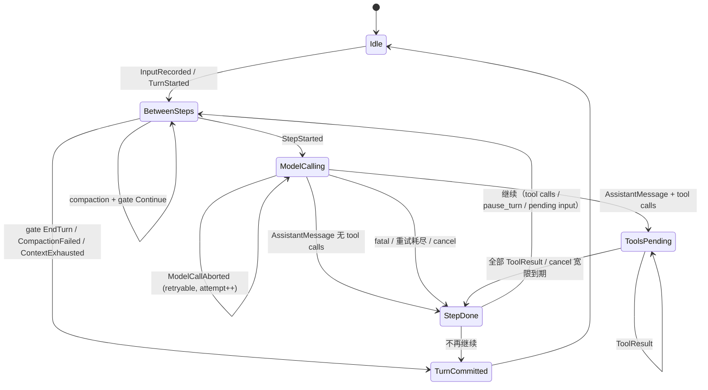

# Agent loop：turn / step、取消与 steering

> 来源：[#6](https://github.com/zibyn/asterpath/issues/6)。本文件定义 loop 的状态机、步进管线、取消与 steering 规则、默认配置。
>
> 对齐：[#3 事件日志与检查点恢复](./event-log-recovery.md)、[#2 模块契约](./module-contracts.md)。
>
> 本票对 #3 的修订（已同步到 `event-log-recovery.md`）：
>
> - `AssistantMessage` 携带 `usage` 与 `stop_reason`；`StepCommitted` 只作检查点标记。
> - 新增 `TimerCancelled`；`TimerScheduled` 增加 `caused_by`。
> - `AbortKind` 增加 `Rejected`；`TurnEndReason` 的改名与新增见 §8。
> - `StreamState` 增加 `TurnOpen`；恢复时若 `AssistantMessage` 已存在，不重调模型。

## 1. 决策摘要

- **回合（turn）由输入驱动**：`InputRecorded` 触发 `TurnStarted`，直到不再需要继续时 `TurnCommitted`。
- **步骤（step）= 一次模型请求 + 由它触发的全部工具调用**；工具全部终结后才写 `StepCommitted`。回合可以零个 step。
- `StepCommitted` 是 step 的**通用终态**：成功、失败、取消都写它；回合结果由 `TurnCommitted.reason` 表达。
- 模型请求的投影水位是 `StepStarted.seq`：只投影它之前的模型可见记录；`CompactionApplied` 作为重写算子不受水位限制。重试复用同一投影；强制压缩后按新投影重试同一 step；steering 在 step 边界进入下一次投影。
- steering 只排队，**不打断**在途模型流；输入到达即写 `InputRecorded`。
- 取消是回合级、协作式；宽限期后 drop 在途工具并写 `Interrupted`；取消同时闭合本 step 的等待意图。
- 模型失败在 step 内按 attempt 重试；工具失败不重试，作为模型可见结果交回模型。
- 默认不设 step 上限；宿主通过 pre-step waterfall gate 实施自己的停止策略。

## 2. 回合与步骤

**回合**：

- 由输入驱动。`InputRecorded` 到达即落盘；驱动方调用 `AgentRunner::run` 时，session 空闲则写 `TurnStarted` 开始新回合，已有回合则把输入作为 steering 并入当前回合。
- 包含零或多个 step。零 step 的回合只可能由 pre-step gate 或压缩路径（失败 / 仍超窗）结束。
- 由 `TurnCommitted { reason }` 结束；之后 session 回到 Idle。

**步骤**：

- `StepStarted` 是意图记录；它之后的模型请求与工具执行都属于该 step。
- `StepCommitted` 是 step 的通用终态：成功、模型失败、取消都写它。`TurnCommitted.reason` 表达回合结果。
- 一个 step 至多一次成功的模型请求（多个 attempt 中至多一个 `AssistantMessage`），零或多个工具调用。
- 模型请求的投影水位是 `StepStarted.seq`：模型可见记录只投影 `seq < StepStarted.seq`；`CompactionApplied` 不受水位限制，始终折叠到 frontier。重试复用同一投影；唯一例外是上下文超限触发的强制压缩，压缩后按新投影重试同一 step（[compaction.md](compaction.md)）；新输入只有落在下一个 `StepStarted` 之前才可见。

**与检查点、追踪、token 的对齐**：

| 概念 | 日志锚点 | 追踪 span | token |
| --- | --- | --- | --- |
| session | `SessionCreated` → | session span | 累计 |
| turn | `TurnStarted` → `TurnCommitted` | turn span | 求和 |
| step | `StepStarted` → `StepCommitted` | step span | 该 step 的模型调用 |
| model attempt | 一次 `AssistantMessage` / 每次 `ModelCallAborted` | model span | `AssistantMessage.usage` |
| tool call | `ToolCallRequested` → `ToolResult` | tool span | — |

## 3. 状态机

状态是日志的投影，不是额外记录：

- `Idle`：没有未闭合的 turn / step / tool / wait 意图（compaction 除外）。
- `TurnOpen`：`TurnStarted` 无 `TurnCommitted`。
  - `BetweenSteps`：没有 open step（`TurnStarted` 之后、`StepStarted` 之前，或刚 `StepCommitted`）。
  - `ModelCalling`：`StepStarted` 无 `AssistantMessage`。
  - `ToolsPending`：`AssistantMessage` 已写，仍有 `ToolCallRequested` 无 `ToolResult`。
  - `Waiting`：`ToolsPending` 且本 step 有未终结的 timer / child / signal 等待。



`StepDone` 在图上只是 `StepCommitted` 的瞬时标记；落在日志里就是 `StepCommitted`。

## 4. 步进管线

```
run_turn(session):
    append(TurnStarted)

    loop:
        if cancelled:
            append(TurnCommitted(Cancelled)); return      # 零 step 取消
        # pre-step：压缩（#9）→ 宿主 gate
        match compact_if_needed(session):                 # 可写 CompactionStarted / CompactionApplied / CompactionAborted
            Ok(NotNeeded | NothingToDo | NotConfigured | Applied) -> {}
            Ok(Insufficient) -> append(TurnCommitted(ContextExhausted)); return
            Err(_)           -> append(TurnCommitted(CompactionFailed)); return
        match pre_step_gate(session):                     # waterfall
            EndTurn(reason) -> append(TurnCommitted(reason)); return
            Err(_)          -> append(TurnCommitted(Failed)); return
            Continue        -> {}

        if steps_started == max_steps_per_turn:
            append(TurnCommitted(MaxStepsExceeded)); return

        step = next_step_id()
        append(StepStarted{turn, step})
        projection = project(frontier, visible_before = StepStarted.seq)  # CompactionApplied 不受水位限制
        force_compacted = false

        # 同一 step 的内层循环：attempt 重试 + 至多一次强制压缩
        loop:
            match call_model(projection, step):            # 内部按 attempt 重试
                Ok(msg):
                    append(AssistantMessage{turn, step, items: msg.items,
                                            raw: msg.raw, usage: msg.usage,
                                            stop_reason: msg.stop_reason})
                    break
                Cancelled:
                    append(ModelCallAborted{turn, step, attempt, kind: Cancelled})
                    append(StepCommitted{turn, step})
                    append(TurnCommitted(Cancelled)); return
                Err(err):
                    append(ModelCallAborted{turn, step, attempt,
                                            kind: err.kind,        # Rejected | Transport
                                            partial: err.partial,
                                            usage: err.partial_usage})
                    # 上下文超限且本 step 未强制压缩过：压缩一次，重试同一 step
                    if err.context_exceeded && !force_compacted:
                        force_compacted = true
                        match compact_forced(session):    # 可写 CompactionStarted / CompactionApplied / CompactionAborted
                            Ok(Applied):
                                projection = project(frontier,
                                                     visible_before = StepStarted.seq)
                                continue              # 内层重试，不新开 step
                            Ok(_):                    # Insufficient / NothingToDo / NotNeeded / NotConfigured
                                append(StepCommitted{turn, step})
                                append(TurnCommitted(ContextExhausted)); return
                            Err(_):
                                append(StepCommitted{turn, step})
                                append(TurnCommitted(CompactionFailed)); return
                    append(StepCommitted{turn, step})
                    append(TurnCommitted(if err.context_exceeded
                                         { ContextExhausted } else { Failed })); return

        calls = msg.tool_calls
        if !calls.is_empty():
            for call in calls:
                append(ToolCallRequested{turn, step, tool_call_id, name,
                                         raw_args, replay, provenance})
            results = execute_tools(calls)                 # #7：审批、并行/独占、超时、截断
            for r in results:
                append(ToolResult{tool_call_id, status, output})
            if cancelled:
                await_up_to(cancel_grace)                  # 工具在宽限内自行收尾
                close_step_waits()                         # 到期后 loop 收起剩余等待
                for unfinished: append(ToolResult{Interrupted, None})
                append(StepCommitted{turn, step})
                append(TurnCommitted(Cancelled)); return

        append(StepCommitted{turn, step})

        if stop_reason == ContextWindowExceeded:
            append(TurnCommitted(ContextExhausted)); return
        if !calls.is_empty() || stop_reason == PauseTurn || has_pending_input(session):
            continue
        append(TurnCommitted(Completed)); return
```

- `call_model` 的每次失败都写 `ModelCallAborted`；只有成功的 attempt 写 `AssistantMessage`。重试不新开 step，投影不变。
- 未装配 Compactor 时 `compact_if_needed` 返回 `NotConfigured` 并继续；`compact_forced` 返回 `NotConfigured`，按内层 `Ok(_)` 分支收尾为 `ContextExhausted`（[compaction.md](compaction.md) §6）。
- `has_pending_input` = 本回合最后一个 `StepStarted` 之后存在 `InputRecorded`。
- 工具审批 `Ask` 会让 step 在 `Waiting` 中跨天保持 open；决定记录为 `SignalReceived`，恢复与调度见 [tools.md](tools.md)。
- 工具执行中取消的收尾顺序见 §6。

### 4.1 恢复入口

驱动方对已打开的回合调用同一管线，但：

- 不重复写 `TurnStarted`。
- 若 frontier 落在 open step 内，不重复写 `StepStarted`，复用原 `StepStarted.seq` 作为投影水位。
- 若该 step 已有 `AssistantMessage`，跳过模型调用，直接执行未终结的工具。
- 若该 step 无 `AssistantMessage` 且最后一条 `ModelCallAborted` 是 `Crash` / `Transport`，按重试策略重调模型；`Transport` 耗尽则 `StepCommitted` + `TurnCommitted(Failed)`。
- 若最后一条 abort 是 `Cancelled` / `Rejected`，按取消/失败收尾，不重试（#3 §6）。
- 若 frontier 之后存在未闭合的 `CompactionStarted`，先按 [event-log-recovery.md](event-log-recovery.md) §2b 补终态，再投影并重试同一 step。
- 工具完成后写 `StepCommitted`，再按 §4 的继续规则决定下一个 step 或 `TurnCommitted`。
- open 的 spawn 工具按 `Safe` 重放；`spawn` / `await_completion` 吸收 R1–R3（[subagents.md](subagents.md) §9）。恢复不为 child 等待另设预收尾路径。

### 4.2 事件序列示例

**正常两步（第一步有工具调用）**

```
InputRecorded
TurnStarted
StepStarted
AssistantMessage{usage, stop_reason: ToolUse}
ToolCallRequested
ToolResult{Completed}
StepCommitted
StepStarted
AssistantMessage{usage, stop_reason: EndTurn}
StepCommitted
TurnCommitted{Completed}
```

**step 运行中到达 steering**

```
StepStarted(step 1)
AssistantMessage{ToolUse}
ToolCallRequested
InputRecorded              # 到达即落盘；step 1 的投影不含它
ToolResult{Completed}
StepCommitted
StepStarted(step 2)        # 投影含 InputRecorded
...
```

**工具执行中取消（宽限到期）**

```
StepStarted
AssistantMessage{ToolUse}
ToolCallRequested
[cancel]
[grace 到期]
ToolResult{Interrupted}
StepCommitted
TurnCommitted{Cancelled}
```

**崩溃于 AssistantMessage 之后**

```
StepStarted
AssistantMessage{ToolUse}
ToolCallRequested
[kill -9]
StreamResumed
ToolResult{Completed}      # Safe 工具重跑一次；Unsafe 写 Interrupted
StepCommitted
...
```

## 5. Steering

- 入口：`SessionHandle::submit_input(input)` 立即 `append(InputRecorded)`（dedup key = 调用方 input id），并通知正在运行的回合。
- **不打断**在途模型流。drain 点是 step 边界：`StepCommitted` 之后、下一个 `StepStarted` 之前。
- 多个输入按 `seq` 顺序进入下一次投影。
- 模型刚返回且无工具调用时，若有 pending input，同一回合继续下一个 step。
- 回合结束后到达的输入不属于旧回合；驱动方在 Idle 时开始新回合。
- 持久等待中的输入不会唤醒等待：等待由 timer / signal / 子会话完成驱动；要放弃等待用取消（然后开新回合）。

## 6. 取消

- `SessionHandle::cancel()`：回合级、幂等。Idle 时是 no-op；取消后 session 仍接受新输入（新回合）。
- **模型流中**：立即 abort，写 `ModelCallAborted{Cancelled}`，不重试；`StepCommitted`；`TurnCommitted(Cancelled)`。
- **退避等待中**：打断 sleep，同上。
- **工具执行中**：向所有在途工具发取消信号；在 `cancel_grace` 内返回的工具按真实结果记 `Completed` / `Failed`；到期仍未返回的 drop future 并写 `ToolResult{Interrupted, output: None}`。已写入的结果不覆盖。外部子进程/MCP server 在宽限后强杀，见 [tools.md](tools.md) §6。
- **等待意图**：到期后由驱动方收尾——`TimerScheduled` 写 `TimerCancelled`；`ChildSessionSpawned` 请求 scheduler 取消子会话并写 `ChildSessionCompleted{Cancelled{Parent}}`（正常运行时 scheduler 是父流子生命周期记录的唯一写者）；signal 等待由工具的 `ToolResult{Interrupted}` 收尾。子会话自己的终态见 [subagents.md](subagents.md)。
- 顺序：取消信号 → 宽限 → 收尾等待 → `StepCommitted` → `TurnCommitted(Cancelled)`。
- 取消不重试、不恢复：已提交的取消记录让恢复跳过该 step。

## 7. 失败与重试

- `ProviderError`（#11）提供 `retryable` 与规范化分类（含上下文窗口耗尽）。
- 只在 `retryable && attempt < max_attempts && !cancelled` 时重试；每次失败写 `ModelCallAborted{attempt, kind: Transport}`。
- 不可重试错误：`ModelCallAborted{kind: Rejected}`，结束回合（`Failed`；上下文窗口耗尽时先强制压缩一次并重试同一 step，仍超限才 `ContextExhausted`；压缩调用失败则 `CompactionFailed`，见 [compaction.md](compaction.md)）。
- 退避：指数 ×2，jitter，cap 30s；可被取消打断。
- 每次 attempt 受 `request_timeout` 约束；超时按可重试 `Transport` 处理。
- 部分流：不写 `AssistantMessage`；`partial` 仅作诊断，不投影（I9）。
- 失败 attempt 的 usage 是 best-effort（`ProviderError.partial_usage` → `ModelCallAborted.usage`）；只进 `partial` 桶，不计入总量（[usage.md](usage.md)）。
- **工具失败不重试**：`ToolResult{Failed}` 是模型可见结果，回合继续。超时、panic 的映射见 [tools.md](tools.md) §6。

## 8. 结束路径

| 条件 | `TurnEndReason` |
| --- | --- |
| 无工具调用、无 `pause_turn`、无 pending input | `Completed` |
| refusal / 空响应 / 输出 `max_tokens` 截断 | `Completed`（`stop_reason` 留在 `AssistantMessage`） |
| 用户取消 | `Cancelled` |
| 模型错误不可重试 / 重试耗尽 | `Failed` |
| `max_steps_per_turn` 达到 | `MaxStepsExceeded` |
| 宿主 gate 返回停止 | `Stopped { reason }` |
| 上下文窗口耗尽：`stop_reason` 超限，或强制压缩后仍超限 | `ContextExhausted` |
| 压缩阶段失败 | `CompactionFailed` |
| gate 自身出错 | `Failed` |

- `pause_turn` 是「继续」控制信号，不新增输入、不结束回合。
- 不自动续写被截断的输出；宿主可以再发输入。

## 9. 追踪与 token 对齐

- span 层级：session → turn → step → model_call / tool_call / wait；transport attempt 折叠为 `model_call` span 上的 event。见 [tracing.md](tracing.md)。
- 成功的模型调用在 `AssistantMessage` 收尾，`usage` 挂在这里；失败的 attempt 在 `ModelCallAborted` 收尾。
- step 在 `StepCommitted` 收尾，回合在 `TurnCommitted` 收尾。
- token 总量 = 该范围内 `AssistantMessage.usage` 求和；中断 attempt 的 partial usage 单独标注（[usage.md](usage.md)）。
- 每次 append 承载 usage 的终态记录后，loop 发一条 `UsageRecorded`（`AssistantMessage` / `CompactionApplied` / `ModelCallAborted`）；它是唯一发射点（#13）。

## 10. 默认配置

```rust
pub struct TurnConfig {
    pub max_steps_per_turn: Option<u32>,   // None
    pub max_attempts: NonZeroU32,          // 3
    pub initial_backoff: Duration,         // 1s
    pub max_backoff: Duration,             // 30s
    pub request_timeout: Option<Duration>, // Some(600s)
    pub cancel_grace: Duration,            // 10s
}
```

| 配置 | 默认 | 说明 |
| --- | --- | --- |
| `max_steps_per_turn` | `None` | 宿主可设；超限 `MaxStepsExceeded` |
| `max_attempts` | `3` | 含首次 |
| `retry_backoff` | 1s 指数 ×2，cap 30s，jitter | 仅 retryable |
| `request_timeout` | `600s` | 每次 attempt；`None` 关闭 |
| `cancel_grace` | `10s` | 0 = 立即 drop |
| `tool_timeout` | `None` | 由 `ToolDescriptor` 决定；external 缺省 120s |
| `tool_kill_grace` | `5s` | 超时/取消后强杀外部工具的宽限（#7） |
| pre-step gate | 无 | 宿主注册 waterfall |
| host stop | 无 | 宿主经 gate 返回 `Stopped { reason }` |
| cost/budget 扩展 | 无 | 模块订阅 `UsageRecorded`，经 gate 返回 `Stopped { reason }`；最多超支一个 step；价格表/币种不在内核（#13） |

## 11. 验收场景

| # | 场景 | 断言 |
| --- | --- | --- |
| L1 | 两步正常回合（第一步工具调用） | 事件序列符合 §4.2 示例；第二步投影含 `ToolResult`；恰一条 `TurnCommitted(Completed)` |
| L2 | step 运行中提交 steering | 输入立即 `InputRecorded`；本 step 投影不含它；下一 step 投影含它；同一回合 |
| L3 | 模型流中取消 | `ModelCallAborted{Cancelled}` + `StepCommitted` + `TurnCommitted(Cancelled)`；恢复不重试 |
| L4 | 工具执行中取消，宽限到期 | 未返回工具写 `Interrupted`；回合 `Cancelled`；timer 等待写 `TimerCancelled` |
| L5 | 可重试错误两次后成功 | 两条 `ModelCallAborted{attempt 1,2}`；恰一条 `AssistantMessage`；usage 只来自成功调用 |
| L6 | 不可重试错误 | `ModelCallAborted{Rejected}` + `StepCommitted` + `TurnCommitted(Failed)`；恢复不重试 |
| L7 | `max_steps_per_turn = 1` 且第一步有工具调用 | 工具完成后 `TurnCommitted(MaxStepsExceeded)` |
| L8 | 空响应 / refusal | `AssistantMessage` 空或含 refusal；`TurnCommitted(Completed)`；`stop_reason` 保留 |
| L9 | 上下文窗口耗尽 | 错误路径：同一 `StepStarted` 内强制压缩一次并重试（无第二个 `StepStarted`，重试投影含压缩结果），成功则回合继续，仍超限则 `ContextExhausted`；压缩调用失败则 `CompactionFailed`；`stop_reason` 路径：不压缩，直接 `ContextExhausted`；每 step 至多一次强制压缩 |
| L10 | 压缩阶段失败 | 零 step；`CompactionAborted` + `TurnCommitted(CompactionFailed)` |
| L11 | 崩溃于 `AssistantMessage` 之后、`StepCommitted` 之前 | 恢复不重调模型；恰一条 `AssistantMessage`；usage 保留；补完未完成工具后提交 step |
| L12 | 投影水位 | step 中记录的 steering 不会被同一 step 的重试看到；只被下一 step 看到 |
| L13 | 崩溃于 `ModelCallAborted{Cancelled}` 之后、`StepCommitted` 之前 | 恢复写 `StepCommitted` + `TurnCommitted(Cancelled)`；不重调模型 |

## 12. 留给下游

- **#7**：已定。工具契约、审批、并行/独占调度、超时与结果形状见 [tools.md](tools.md) 与 [ADR-0007](../adr/0007-approval-and-sandbox-layers.md)。
- **#8**：已定。spawn 是同步工具调用；取消、`ChildSessionCompleted{Cancelled}` 与孤儿策略见 [subagents.md](subagents.md)。
- **#9**：已定。触发、保留、摘要调用、事件与归因见 [compaction.md](compaction.md) 与 [ADR-0009](../adr/0009-context-compaction.md)。
- **#11**：已定。`ProviderError` 的 retryable/上下文分类、`Usage`、`StopReason`（含 `PauseTurn`、`ContextWindowExceeded`）见 [protocol.md](protocol.md)。
- **#12**：span 命名与属性映射。
- **#13**：已定。token 聚合、`partial` 桶、`UsageRecorded` 发射点见 [usage.md](usage.md)。
- **#15**：已定。`AgentRunner::run` / `SessionHandle::drive` / `AgentEvent` / `AgentError` 的精确签名与驱动模型见 [packaging.md](packaging.md) §3.3–§3.4。
- **#17**：已定。timer/signal API、spawn 工具重放吸收 R1–R3、`DurableExecutor` 接缝见 [ADR-0014](../adr/0014-subagent-scheduling-api.md)。
- **#27**：已定。`Compactor` 契约、未装配时的 `NotConfigured` 路径见 [protocol.md](protocol.md) §6.1 与 [packaging.md](packaging.md) §3.3–§3.4。
