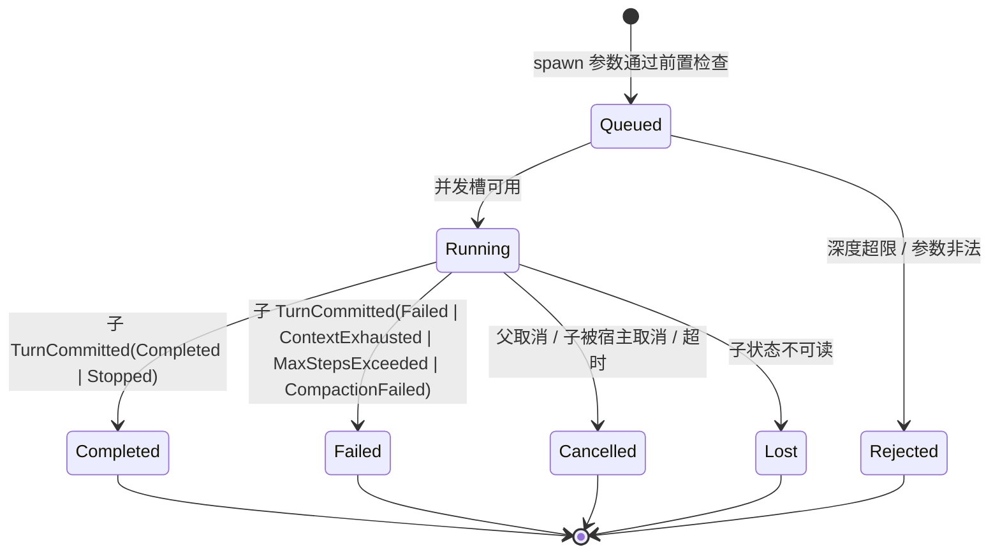

# 子智能体：子会话、上下文、等待与恢复

> 来源：[#8](https://github.com/zibyn/asterpath/issues/8)；API 接缝由 [#17](https://github.com/zibyn/asterpath/issues/17) 定形（[ADR-0014](../adr/0014-subagent-scheduling-api.md)）。本文件定义子智能体的**语义**：spawn 入口、上下文策略、结果形状、配置继承、并发与深度、取消传播、孤儿恢复与恢复接缝。`Item` / `Part` / `ConfigSnapshot` / `Usage` 类型归 [#11](https://github.com/zibyn/asterpath/issues/11)，token 聚合口径见 [usage.md](usage.md)（#13）。
>
> 对齐：[#3 事件日志与检查点恢复](./event-log-recovery.md)、[#6 agent loop](./agent-loop.md)、[#7 工具契约](./tools.md)。
>
> 本票对 #3 的修订（已同步到 `event-log-recovery.md`）：
>
> - 新增子流事件 `ContextForked`。
> - `ChildSessionSpawned` 增加 `config` 与 `context`。
> - `ChildOutcome` 在本文件定形。
>
> 相关 ADR：[0008 子智能体是同步工具调用拥有的独立子会话](../adr/0008-subagent-model.md)。

## 1. 决策摘要

- **子智能体 = 独立子会话**：独立日志流、独立恢复与取消单位；父流只记生命周期（#3）。
- **spawn 是一次工具调用**，同步等待子会话完成；v1 没有后台/异步 spawn。fan-out = 同一 `AssistantMessage` 里多个 spawn 调用并行。
- **默认全新上下文（fresh）**；`context: fork` 按次 opt-in，fork 是 spawn 时刻父投影的**物化快照**，不是活引用。
- **父流只记四类记录**：spawn 的 `ToolCallRequested`、`ChildSessionSpawned`、`ChildSessionCompleted`、spawn 的 `ToolResult`。子的 step / 工具 / 计划只在子流。
- **结果 = 状态 + 任务总结**。子任务失败仍是成功的 spawn 工具结果；只有基础设施问题才是工具失败。
- **配置在 spawn 时刻快照继承**，模型只能收窄（模型 alias 白名单、工具 allowlist），不能放宽审批或替换 system prompt。
- **默认深度 3、每父并发 8、调度器全局 32**；并发超限 FIFO 排队，深度超限直接失败。
- **取消从父传播到子**；进入取消路径后一律记 `Cancelled{Parent}`（已落盘的 `ChildSessionCompleted` 除外）。父不写子流，子不写父流。
- **孤儿 = 父已不再等待的子会话**；子恢复时发现即按取消收尾，不再开新 turn。
- **usage 不复制进父日志**；父子归因靠 session 树，查询时 rollup。

## 2. 实体

| 词 | 含义 | 本文件中的边界 |
| --- | --- | --- |
| 子智能体 | 父会话委托、独立上下文运行的模型会话 | 模型/宿主角度 |
| 子会话 | 子智能体的持久化形态：独立日志流与恢复单位 | 日志角度 |
| 任务 | 交给子智能体、有明确开始与终态的工作单元 | 生命周期：spawn / wait / complete / cancel |
| 工作流 | 作者代码固定的控制流 + 确定性重放 | v1 不存在；出界 |
| 任务总结 | 子最后一条已提交助手消息的文本/拒绝内容 | 父模型看到的结果 |
| 孤儿会话 | 父已不再等待、自身仍有未闭合回合的子会话 | 恢复时按取消收尾 |

术语定义见 [GLOSSARY.md](../../GLOSSARY.md)。

## 3. Spawn 入口与生命周期

### 3.1 能力与工具

`asterpath-scheduler` 模块提供两样东西：

1. 进程内能力 `SubagentSpawner`（宿主也可用）；
2. 模型可见的 spawn 工具（`spawn_agent`；#16 已定：进程内工具用裸名，外部工具有 `__` 命名空间，不冲突），是 `SubagentSpawner` 的薄包装。

API（[#17](https://github.com/zibyn/asterpath/issues/17) 定形，见 [ADR-0014](../adr/0014-subagent-scheduling-api.md)）：

```rust
pub trait SubagentSpawner: Send + Sync {
    fn spawn(&self, req: SpawnRequest) -> BoxFuture<'_, Result<ChildRef, SpawnError>>;
    fn await_completion(&self, child: &ChildRef)
        -> BoxFuture<'_, Result<ChildOutcome, WaitError>>;
    fn cancel(&self, child: &ChildRef) -> BoxFuture<'_, Result<(), WaitError>>;
}

pub struct SpawnRequest {        // #[non_exhaustive]
    pub parent: ParentRef,       // parent session / turn / tool_call
    pub caused_by: LogId,        // 本次 spawn 的 ToolCallRequested
    pub task: Vec<Part>,
    pub context: ContextPolicy,  // Fresh | Fork { at: LogId }
    pub model_alias: Option<ModelAlias>,
    pub tool_allowlist: Option<Vec<ToolName>>,
    pub timeout: Option<Duration>,
}

pub struct ChildRef { pub parent: ParentRef, pub child: SessionId }

pub enum SpawnError {
    DepthExceeded,                    // 未创建子会话
    InvalidArgs { message: String },
    Execution(ExecutionError),
}
pub enum WaitError { Cancelled, Timeout, Execution(ExecutionError) }

pub enum ContextPolicy {
    Fresh,
    Fork { at: LogId },          // spawn 所在 step 的 StepStarted.log_id
}
```

分工：

- **`spawn` = 意图 + R1/R2**：按 `parent_tool_call_id` 查已有 `ChildSessionSpawned`（R1），没有才创建；物化子流缺失记录并重新入队（R2）；返回 `ChildRef` 后立即返回，不等待完成。幂等。
- **`await_completion` = R3 + 持久等待**：先读父流已记录的 `ChildSessionCompleted`（R3）；否则再次幂等补齐 R2，然后经 `DurableExecutor::await_wake` 等待子完成。子终态到达时由 scheduler 写 `ChildSessionCompleted`。
- **`cancel` = 父侧收尾**：请求子会话取消，最多等 `cancel_grace`；已记录 outcome 不覆盖，否则写 `ChildSessionCompleted{Cancelled{Parent}}`。
- **`timeout` = 持久 timer**：`spawn` 经 `DurableExecutor::schedule_timer` 写 `TimerScheduled`（`caused_by` = `ChildSessionSpawned` 的 `LogId`，deadline 为绝对时间）；到期时子流已有终态则用终态，否则写 `Cancelled{Timeout}`。`await_completion` 对 `Cancelled{Timeout}` 返回 `WaitError::Timeout`。
- **排队是内存状态**：Queued/Running、每父与全局并发计数、wake 注册表都不落日志；恢复按 open `ChildSessionSpawned` 的 `seq` 重建 FIFO。没有 `spawn_many` / join：fan-out 靠 #7 的并行工具调用。
- **`SpawnError` 才表示没有子会话**；任务失败是 `ChildOutcome::Failed`，仍是成功的 spawn 工具结果。
- **`WaitError::Cancelled` / `Timeout`** 分别映射 `ToolResult{Interrupted}` / `Failed{Timeout}`；子被自己的宿主取消返回 `Ok(Cancelled{Host})`，映射 `ToolResult{Completed}` 并在 output 标明 cancelled。

`DurableExecutor` 接缝（core，[#17](https://github.com/zibyn/asterpath/issues/17)）：

```rust
pub trait DurableExecutor: Send + Sync {
    fn schedule_timer(&self, req: TimerRequest)
        -> BoxFuture<'_, Result<TimerId, ExecutionError>>;
    fn cancel_timer(&self, session: SessionId, timer: TimerId)
        -> BoxFuture<'_, Result<(), ExecutionError>>;
    fn await_signal(&self, req: AwaitSignal)
        -> BoxFuture<'_, Result<SignalPayload, ExecutionError>>;
    fn deliver_signal(&self, delivery: SignalDelivery)
        -> BoxFuture<'_, Result<(), ExecutionError>>;
    fn await_wake(&self, session: SessionId, cause: WakeCause)
        -> BoxFuture<'_, Result<(), ExecutionError>>;
    fn wake(&self, session: SessionId, cause: WakeCause);   // 仅内存
}

pub struct AwaitSignal {
    pub session: SessionId,
    pub signal: SignalId,
    pub name: SignalName,
    pub caused_by: LogId,
    pub intent: SignalIntent,        // Record | AlreadyRecorded（审批）
}
```

- timer id 由 `(session, caused_by, slot)` 确定性派生；通用 signal id 由 `(session, name)` 派生，审批 signal id 即 `tool_call_id`。重复注册返回同一 id，恢复重放不会制造第二个等待。
- `await_signal` 只在 `SignalIntent::Record` 时写 `SignalAwaited`；审批用 `AlreadyRecorded`，由 open 的 `ToolCallRequested` 承担意图（#7）。
- `schedule_timer` / `cancel_timer` 分别写 `TimerScheduled` / `TimerCancelled`，timer 服务写 `TimerFired`；同一 timer 只会有 `TimerFired` 或 `TimerCancelled` 之一。
- `wake` 由终态记录的写者在 append 之后调用；注册表只在内存，恢复靠扫描日志重建。

工具描述：

| 字段 | 值 |
| --- | --- |
| parallelism | `Parallel` |
| replay | `Safe`（由 R1 保证，见 §9） |
| side_effect | `Mutating` |
| provenance | `InProcess` |
| timeout | `None`（可用按次 `timeout` 参数覆盖；管线执行，工具观察 `CancelToken`） |
| approval | 默认策略 `InProcess → Allow`；宿主可用自定义策略收紧 |

- spawn 的 `ReplaySafety::Safe` 是框架声明：恢复会先按 `parent_tool_call_id` 查找已有子会话（R1），不会产生第二个子。
- 工具参数 schema 与 `task` 的编码（字符串 → 一个 user text `Part`）归 #15/#17。
- **host 不经 turn / tool call 直接 spawn 在 v1 不做**：等待需要一个 `caused_by` 锚点（#3）。宿主可以注册自己的工具包装 `SubagentSpawner`，或通过输入让模型决定。

### 3.2 创建顺序

父会话：

```text
ToolCallRequested { tool = spawn_agent, args = effective args }
ChildSessionSpawned { child, task, config, context, parent_tool_call_id, caused_by }
    ↓ 子会话开始运行（scheduler 驱动）
ChildSessionCompleted { child, outcome }
ToolResult { status = Completed | Interrupted | Failed, ... }
```

子会话（fresh）：

```text
SessionCreated { config, parent: Some(ParentRef) }
InputRecorded { task }          # dedup key = child id
TurnStarted
...
TurnCommitted { reason }
```

子会话（fork）：

```text
SessionCreated { config, parent: Some(ParentRef) }
ContextForked { source: ParentRef, source_log, items }
InputRecorded { task }
TurnStarted
...
TurnCommitted { reason }
```

- `caused_by` = spawn 那条 `ToolCallRequested` 的 `LogId`；`parent_tool_call_id` 是 `ToolCallId`。
- 子会话创建后**自动开第一个 turn**，不需要宿主再投输入。
- `ChildSessionSpawned` 与子流的 `SessionCreated` 由 scheduler 写；`ChildSessionCompleted` 也归 scheduler（正常运行时父流的子生命周期记录只有它写）；父驱动方只写 `ToolResult` 与其他 loop 事件。恢复期间由父驱动方代写缺失的 `ChildSessionCompleted`（#3 §6），二者不并发。
- 父子之间没有原子性：父记录先写，子流后写；中间崩溃由 R2 物化。

### 3.3 等待

- 父的等待是**持久等待**：open `ChildSessionSpawned`（无 `ChildSessionCompleted`），step 处于 `Waiting`（#3 §6、#6 §3）。
- spawn 工具调用保持 open，直到子终态被记录；父崩溃后恢复重新挂起，不重调模型。
- 等待中的 steering 不唤醒等待（#6 §5）；放弃等待用取消。
- fan-out = 同一 `AssistantMessage` 里的多个 spawn 调用；它们按 #7 的并行/独占规则调度，step 等全部调用终结后才提交。

### 3.4 生命周期图



`Queued` 是内存状态，不落日志；崩溃后按 open 的 spawn 工具调用重建队列。

## 4. 上下文策略

### 4.1 fresh（默认）

- 子只看到：继承的 system prompt（来自配置快照）+ `InputRecorded{task}`。
- 不含父历史、父的 steering、父的工具输出。
- 默认 fresh 的理由：成本可预测、父上下文不泄漏、与 Codex/Claude Code 的默认一致。

### 4.2 fork（opt-in）

```rust
ContextForked {
    source: ParentRef,      // 父 session / turn / tool_call
    source_log: LogId,      // spawn 所在 step 的 StepStarted.log_id
    items: Vec<Item>,       // 父投影快照
}
```

- `items` 是**投影后的快照**，尊重 `CompactionApplied`；不是原始事件的复制。
- 水位是 spawn 所在 step 的 `StepStarted.seq`：子看不到"自己这次 spawn"的 `AssistantMessage`，也看不到同 step 的兄弟工具结果。
- 快照**物化进子日志**，不是对父日志的活引用；父后续压缩、归档或删除不影响子会话。
- fork 之后父子互不影响：子在快照 + task 上继续，父继续自己的回合。
- 成本：快照复制父上下文一次；受父上下文窗口上界约束。
- 跨供应商不透明 reasoning 不翻译（地图已出界）；fork 只复制规范 `Item` 与原样保留的 provider 数据。

## 5. 配置继承

- **spawn 时刻快照**：provider、model、system prompt、工具集、审批策略标识、MCP 配置、limits 解析进子会话的 `ConfigSnapshot`，写入 `SessionCreated.config` 与父流的 `ChildSessionSpawned.config`。
- 之后父配置变化不影响已 spawn 的子；子配置变化也不回写父。
- 模型可见的 spawn 参数只能收窄：
  - `model_alias` 必须来自宿主提供的 alias 集合（pre-execute 解析成具体模型并写进 effective args）；未知 alias → `Failed{InvalidArgs}`。
  - `tool_allowlist` 只能是父工具集的子集；不能新增工具或把 `External` 工具提升为 `InProcess`。
  - system prompt、审批策略、MCP 配置、limits **不能**由模型参数改写；宿主可程序化收紧。
- 沙箱/隔离由扩展模块或宿主按其继承策略决定；内核只带 `Provenance`（#7）。
- 子的工具调用走自己的 session 与审批策略；父的审批不覆盖子。
- 恢复一致性：物化子会话时断言 `SessionCreated.config == ChildSessionSpawned.config`；不一致是硬错误。

## 6. 结果

```rust
pub enum ChildOutcome {
    Completed { summary: Summary },
    Failed { reason: ChildFailure, summary: Summary },
    Cancelled { reason: CancelReason },
    Lost { reason: String },
}

pub enum ChildFailure {
    TurnFailed,
    ContextExhausted,
    MaxStepsExceeded,
    CompactionFailed,
}

/// #17：取消必须带原因，恢复才能稳定还原 ToolResult 形态。
pub enum CancelReason {
    Parent,   // 父取消等待
    Host,     // 子被自己的宿主取消
    Timeout,  // spawn timeout 到期
}

pub struct Summary {
    pub items: Vec<Part>,   // 最后一条已提交 AssistantMessage 的 text / refusal；可空
}
```

- `summary` 取子会话**最后一条已提交 `AssistantMessage`** 的 text/refusal item；剥掉 reasoning 与工具调用；可能为空（例如最后一步只有工具调用）。
- 结果进入父上下文时受 #7 的截断上限（默认 64 KiB/调用）。
- 父不自动获得子的完整 transcript；宿主可通过 `EventLog` 读取子流。

映射：

| 子会话终态 | `ChildOutcome` | spawn 的 `ToolResult` |
| --- | --- | --- |
| `TurnCommitted(Completed)` | `Completed { summary }` | `Completed` |
| `TurnCommitted(Stopped { reason })` | `Completed { summary }` | `Completed` |
| `TurnCommitted(Failed)` | `Failed { reason: TurnFailed, summary }` | `Completed`（output 标明 failed） |
| `TurnCommitted(ContextExhausted)` | `Failed { reason: ContextExhausted, summary }` | `Completed` |
| `TurnCommitted(MaxStepsExceeded)` | `Failed { reason: MaxStepsExceeded, summary }` | `Completed` |
| `TurnCommitted(CompactionFailed)` | `Failed { reason: CompactionFailed, summary }` | `Completed` |
| 子被宿主取消 | `Cancelled { reason: Host }` | `Completed`（output 标明 cancelled） |
| 父取消 | `Cancelled { reason: Parent }` | `Interrupted`（#6 收尾） |
| 超时 | `Cancelled { reason: Timeout }` | `Failed{Timeout}` |
| 子状态不可读 | `Lost { reason }` | `Failed{Internal}` |
| 深度/参数非法 | —（无子会话） | `Failed{InvalidArgs}` |

- **任务失败 ≠ 工具失败**：子跑完并失败，spawn 工具本身成功，模型拿到结构化 outcome；只有基础设施问题（参数、深度、丢失、超时、调度器错误）才是 `Failed`。
- fan-out 的每个 spawn 独立：兄弟失败/取消互不影响；汇总策略由父模型决定。
- v1 不支持对已完成的子会话续聊（`SendMessage` 类）；需要续聊 = 新 spawn + 任务里带上必要上下文。

## 7. 并发、深度与排队

- `child.depth = parent.depth + 1`；root = 0；`max_depth = 3` 表示允许的最大子 depth。超限直接 `Failed{InvalidArgs}`，不创建子会话。
- 并发按**每父会话**计：已创建且未完成的子会话数，默认 `8`。
- 调度器全局 `max_live_children = 32`。
- 超限 **FIFO 排队**，不报错；排队是内存状态（§3.4），崩溃后按 open spawn 调用重建。
- 排队期间 spawn 工具调用保持 open；父取消时排队项直接丢弃。
- 不做跨父公平调度、抢占或优先级；v1 只有 FIFO。

## 8. 取消与关闭顺序

### 父取消

1. 父 `SessionHandle::cancel()` 广播 `CancelToken`；spawn 工具观察 token。
2. 父驱动方把本次 step 的 child 等待标记为 cancelling；scheduler 向子会话发取消。
3. 父最多等 `cancel_grace`（#6，默认 10s）。
4. 收尾顺序：`ChildSessionCompleted{Cancelled{Parent}}` → spawn 的 `ToolResult{Interrupted}` → `StepCommitted` → `TurnCommitted(Cancelled)`。

- **统一规则**：进入 cancelling 的等待一律记 `Cancelled{Parent}`，即使子恰好完成；唯一例外是 `ChildSessionCompleted` 已先落盘（等待已关闭），此时按 R3 使用已记录结果。scheduler 是这些记录的唯一并发写者，按等待状态线性化。
- 排队中（尚无 `ChildSessionSpawned`）的 spawn 没有子可取消，直接 `Interrupted`。
- 父取消不等待子写完自己的终态；`ChildSessionCompleted{Cancelled{Parent}}` 表达的是"父不再等待"，不是"子已停止"。子的实际终态归子流。

### 子取消

- scheduler 发取消 → 子按 #6 协作停止：宽限内返回的工具记真实结果，其余 `Interrupted`；自己的 timer 写 `TimerCancelled`；自己的子会话递归走同一规则（自底向上）。
- 子写 `StepCommitted` + `TurnCommitted(Cancelled)`。
- 父永不写子流；子永不写 `ChildSessionCompleted`。

### 超时

- spawn 的 `timeout` 可选，默认 `None`；它是**持久 timer**（`DurableExecutor::schedule_timer`，`caused_by` = `ChildSessionSpawned` 的 `LogId`，deadline 为绝对时间），不是内存 deadline。停机期间到期，恢复后补一次 `TimerFired`。
- 到期时：子流已有终态则按终态记录；否则 scheduler 写 `ChildSessionCompleted{Cancelled{Timeout}}`，spawn 工具返回 `Failed{Timeout}`。
- 子先完成则取消 timer（`TimerCancelled`），不产生超时记录。
- 超时后让子继续运行（后台模式）v1 不支持。

## 9. 恢复与孤儿

四条不变量：

- **R1 spawn 按查找幂等**：执行 spawn 前先查父流的 `ChildSessionSpawned{parent_tool_call_id}`；存在就续上，绝不创建第二个子。不存在才新建。这是 spawn 工具声明 `ReplaySafety::Safe` 的依据。
- **R2 子物化与启动幂等**：`ChildSessionSpawned` 存在但子流缺记录时，按父记录补写：`SessionCreated`（dedup = child id）→ [`ContextForked`]（dedup = child id）→ `InputRecorded{task}`（dedup = child id）→ `TurnStarted`。缺哪步补哪步。
- **R3 已记录 outcome 优先**：`ChildSessionCompleted` 存在时，spawn 结果直接从它推导，不再查询子；关掉 `ChildSessionCompleted` 与 `ToolResult` 之间的窗口。
- **R4 孤儿 = 父已不再等待**：子恢复时若父流已有 `ChildSessionCompleted{child = me}`，子按取消收尾并停止；父仍有 open 等待则正常恢复。

### 父恢复

open 的 child 等待由 **spawn 工具重放** 收尾（#17：[ADR-0014](../adr/0014-subagent-scheduling-api.md)），不另设 `recover()` 入口，也不在 #3 §6.2 的等待预扫描里预先写 `ChildSessionCompleted`：

```text
for spawn tool call in open ToolCallRequested, 按 seq:
    spawn(req):                         # ReplaySafety::Safe
        R1 查 parent_tool_call_id：
            已有 ChildSessionSpawned -> 复用同一个子，绝不新建
            没有                     -> 正常创建
        R2 物化子流缺失记录，按 seq 重新入队
    await_completion(child):
        R3 父流已有 ChildSessionCompleted -> 直接返回，不查子
        子流 TurnCommitted(reason)       -> Outcome = map(reason);
                                            append ChildSessionCompleted; 返回
        子流不存在 / 运行中              -> 重新挂起，等 await_wake
        子流不可读（Corrupt）            -> append ChildSessionCompleted{Lost};
                                            返回 Err(Execution) -> ToolResult{Failed, Internal}
```

- 写者仍只有 scheduler（正常）或经 `SubagentSpawner` 被父驱动方调用（恢复）；两条路径不并发。
- 等待预扫描若发现 open `ChildSessionSpawned` 却没有对应的 open spawn 工具调用，视为日志损坏。

### 子恢复（孤儿检查）

```text
recover(child):
    若父流有 ChildSessionCompleted{child = me}:
        # R4：父已不再等待
        append StreamResumed
        收尾未闭合意图：工具 -> Interrupted；timer -> TimerCancelled；
                        自己的子会话 -> Cancelled
        append StepCommitted; append TurnCommitted(Cancelled)
        不再开新 turn
    否则:
        正常恢复（#3 §6）
```

- 父记录**缺失**（保留/归档扩展删除了父流）：v1 视为扩展违约，子作为独立 session 继续；不因父缺失而自杀。
- 父流**损坏**：按 #5 硬错误，不做孤儿判定。
- 取消不是持久事件（#6）：父在取消收尾记录落盘前崩溃，恢复会续跑该 turn。这是 #6 已接受的窗口；R4 只兜底"父已经写下不再等待"的情况。

### 崩溃窗口

| 窗口 | 恢复动作 |
| --- | --- |
| `ToolCallRequested` 后、`ChildSessionSpawned` 前 | R1：没有子记录 → 重新执行 spawn（Safe） |
| `ChildSessionSpawned` 后、子 `SessionCreated` 前 | R2：物化子并启动 |
| 子 `TurnCommitted` 后、父 `ChildSessionCompleted` 前 | 读子终态 → 写 outcome → 完成工具 |
| `ChildSessionCompleted` 后、`ToolResult` 前 | R3：从记录完成工具，不查子 |
| 父已写 `ChildSessionCompleted{Cancelled{Parent}}`、子尚未收尾 | R4：子恢复时按孤儿取消 |
| 父取消请求已发出、收尾记录未落盘 | #6 语义：恢复后续跑该 turn（接受） |

## 10. 追踪与 token

- trace：子会话是独立 trace；父 trace 的 `subagent` span 挂在 spawn 的 tool span 下，子 trace 的根 span 用 `parent_trace` / `parent_span` 指回它。关联键 `parent_tool_call_id` / `caused_by`；`ContextForked.source_log` 记在子 session span 上。见 [tracing.md](tracing.md)。
- usage：子的 `AssistantMessage.usage` 只写子流；父日志不复制。
- 聚合：session 总量 = 自身 + 后代，查询时按 session 树 rollup；不存冗余、不重复计数。查询 API 见 [usage.md](usage.md)：`Session` scope 只返回自身，`SessionSubtree` 分开返回 `own` / `descendants`。
- `ChildSessionCompleted` 不携带 usage；避免"父日志 + 子日志"双重计数。

## 11. 默认配置

```rust
pub struct SubagentConfig {
    pub default_context: ContextPolicy,         // Fresh
    pub max_depth: u8,                          // 3
    pub max_concurrent_children: NonZeroUsize,  // 8（每父会话）
    pub max_live_children: NonZeroUsize,        // 32（调度器全局）
    pub spawn_timeout: Option<Duration>,        // None
    pub cancel_grace: Duration,                 // 10s（#6）
}
```

| 配置 | 默认 | 说明 |
| --- | --- | --- |
| default context | `Fresh` | `fork` 按次 opt-in |
| max_depth | 3 | 子 depth 上限；超限 `Failed{InvalidArgs}` |
| max_concurrent_children | 8 | 每父会话 |
| max_live_children | 32 | 调度器全局 |
| 并发超限 | FIFO 排队 | 不报错 |
| spawn timeout | `None` | 按次参数；持久 timer（`DurableExecutor`） |
| cancel_grace | 10s | 沿用 #6 |
| spawn replay | `Safe` | R1 |
| spawn parallelism | `Parallel` | |
| spawn side_effect | `Mutating` | |
| summary 上限 | #7 默认 | 64 KiB/调用 |
| SendMessage / 续聊 | 不支持 | 出界 |

## 12. 验收场景

| # | 场景 | 断言 |
| --- | --- | --- |
| SA1 | fresh spawn 正常完成 | 父序列含 `ToolCallRequested` → `ChildSessionSpawned` → `ChildSessionCompleted` → `ToolResult`；子序列 `SessionCreated` → `InputRecorded` → `TurnStarted` → `TurnCommitted`；父投影只含 summary |
| SA2 | fork | 子首个模型请求含父在 `StepStarted.seq` 的投影快照 + task；不含 spawn 的 `AssistantMessage` 与兄弟工具结果 |
| SA3 | fork 后父压缩/归档 | 子会话内容不变；子恢复不读父日志 |
| SA4 | 崩溃于 `ChildSessionSpawned` 前后 | 前者重新 spawn 一次；后者物化同一个子；两种都没有第二个子会话 |
| SA5 | 崩溃于子 `TurnCommitted` 后、父 `ChildSessionCompleted` 前 | 恢复写恰一条 `ChildSessionCompleted`；spawn 恰一条 `Completed`；不重调模型 |
| SA6 | 崩溃于 `ChildSessionCompleted` 后、`ToolResult` 前 | 恢复从记录完成工具；不查子；恰一条 `ToolResult` |
| SA7 | 父取消等待 | 子收到取消；父 `ChildSessionCompleted{Cancelled{Parent}}` + `ToolResult{Interrupted}` + `TurnCommitted(Cancelled)`；子自己写 `TurnCommitted(Cancelled)` |
| SA8 | 取消与子完成竞态 | 已进入 cancelling 的等待记 `Cancelled{Parent}`；已落盘的 `Completed` 不被覆盖 |
| SA9 | 孤儿恢复 | 父已有 `ChildSessionCompleted{Cancelled{Parent}}`；子恢复后收尾为 `TurnCommitted(Cancelled)`，不开新 turn |
| SA10 | 深度超限 | `Failed{InvalidArgs}`；不创建子会话 |
| SA11 | 并发超限 | 第 9 个子排队；前一个完成后按 FIFO 启动；无错误 |
| SA12 | fan-out 部分失败 | 三个 spawn：一个 `Failed`、两个 `Completed`；兄弟互不影响；父拿到三个独立结果 |
| SA13 | 子 `MaxStepsExceeded` | `ChildOutcome::Failed{reason}`；spawn `ToolResult` 为 `Completed`，output 标明 failed |
| SA14 | 超时 | 子取消；`ChildSessionCompleted{Cancelled{Timeout}}`；spawn `Failed{Timeout}`；子先完成则 `TimerCancelled` |
| SA15 | 子流损坏 | `ChildSessionCompleted{Lost}`；spawn `Failed{Internal}`；父不被永久阻塞 |
| SA16 | token 归因 | 父 session 日志不含子 usage；父总量按 session 树 rollup 等于自身 + 后代；无重复计数 |
| SA17 | 子内审批 | 子工具调用使用子 session 的审批策略；父审批不覆盖；子审批等待可跨崩溃 |

## 13. 出界与非目标

- 后台/异步子智能体与"完成时注入父上下文"：v1 只做同步持久等待。
- 对已完成子会话续聊（`SendMessage` 类）：需要"恢复子会话"语义，v1 不做。
- 宿主绕过 turn/tool call 直接 spawn：等待缺少 `caused_by` 锚点。
- 子完整 transcript 自动注入父上下文：只给 summary；宿主可自行读子流。
- planner / map-reduce / critic 等编排模式：宿主应用，不在框架。
- 每子沙箱 profile、成本预算、内容脱敏：扩展模块/宿主（地图扩展点）。
- 跨父公平调度、抢占、优先级：v1 只有 FIFO。
- 跨供应商不透明 reasoning 翻译：地图已出界。

## 14. 留给下游

- **#9**：子会话内的压缩策略；fork 快照尊重父的 `CompactionApplied`，但物化后与父压缩解耦。
- **#11**：已定。`Item` / `Part`、`ConfigSnapshot`、`ContextPolicy`、`ChildOutcome` 的最终类型与 summary 的渲染见 [protocol.md](protocol.md)。
- **#12**：已定。父 `subagent` span 与子 trace 根 span 的链接、`caused_by` / `source_log` 映射见 [tracing.md](tracing.md)。
- **#13**：已定。session 树 rollup、去重口径与子 usage 查询见 [usage.md](usage.md)；树边由 core 的 `SessionCatalog` 提供。
- **#15**：spawn 工具的最终命名/参数 schema；`SubagentSpawner` 的打包位置。
- **#16**：已定。`spawn_agent` 是进程内工具的裸名；外部工具一律 `<plugin_id>__<tool>`，`__` 保留，因此不与 `spawn_agent` 冲突。见 [plugins.md](plugins.md) §6。
- **#17**：已定。`SubagentSpawner` 签名与 spawn/await/cancel 分工、持久超时、恢复委托、`DurableExecutor` 接缝见 §3.1/§9 与 [ADR-0014](../adr/0014-subagent-scheduling-api.md)；原型在 `prototype/subagent-api` 分支。
- **#18**：保留/归档必须保证父子流在对方仍活跃时不被删除；违反时按 §9 的缺失策略处理。
- **#19**：R1–R4 的崩溃注入点与确定性测试。
