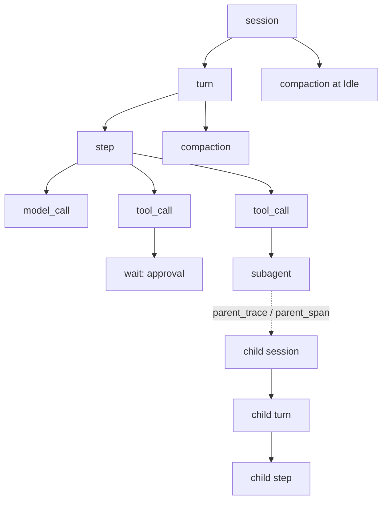

# 原生执行链追踪模型

> 来源：[#12](https://github.com/zibyn/asterpath/issues/12)。本文件定义原生 trace 的数据模型、挂接点与查询：查询是 facade 方法 `Asterpath::trace(session)`，返回 `Vec<Span>`，折叠在引擎模块 `views::trace`；实时导出由宿主在 `Hooks::on_record` 上自行增量折叠。
>
> 对齐：[事件日志与检查点恢复](event-log-recovery.md)、[Agent loop](agent-loop.md)、[子智能体](subagents.md)、[上下文压缩](compaction.md)、[协议模型](protocol.md)、[OTel GenAI 研究](../research/otel-genai-conventions.md)。
>
> 相关 ADR：[0011 追踪与用量是日志投影](../adr/0011-native-tracing.md)。

## 1. 决策摘要

- **trace 是事件日志的确定性投影**。没有独立 trace sink，不落 trace 表，不引入 OTel SDK 或第三方追踪框架。
- **日志信封带诊断时间** `recorded_at`（Unix ms，存储层写入）。trace 的起止与耗时由它计算；恢复、投影、分支逻辑一律不得读取。
- **层级**：`session → turn → step → model_call / tool_call / subagent / wait`；`compaction` 是独立的模型调用 span，挂在 turn 或 session 下。
- **一个逻辑模型调用一个 span**，所有 transport attempt 折叠为 span event；等待（approval / child）是独立 span。
- **身份确定**：`TraceId = SessionId`，`SpanId` 由开启该 span 的日志记录确定性派生。重建得到相同 ID；恢复复用已存在的开启记录，不产生重复 span。
- **恢复不新建 trace**：`StreamResumed` 记为 session span 上的 `resume` event；跨恢复的 span 标 `replay`。
- **只有 pull 查询**：`Asterpath::trace(session)` 按需从 `SessionStore` 的日志折叠该会话的全部 span。值类型在 `asterpath-protocol`，折叠在引擎内部（`views::trace`）。没有推送：实时导出由宿主在 `Hooks::on_record` 上自行增量折叠（ADR-0026）。
- **内容永不进 trace**：span 只带 `log_range` 引用。采样、过滤、格式、内容捕获与脱敏由 exporter/host 决定，默认关闭内容。

## 2. 类型（`asterpath-protocol`）

```rust
pub type Timestamp = i64;                 // Unix epoch ms，与 #5 一致

pub struct TraceId(SessionId);            // 16 字节；一条 trace 一个会话
pub struct SpanId([u8; 8]);

#[non_exhaustive]
pub enum SpanKind {
    Session, Turn, Step, ModelCall, ToolCall, Subagent, Wait, Compaction,
}
pub enum WaitKind { Approval }
pub enum SpanStatus { Unset, Ok, Error, Cancelled, Interrupted }

#[non_exhaustive]
pub enum ErrorType {
    ProviderRejected, Transport, ToolInvalidArgs, ToolDenied, ToolTimeout,
    ToolPanic, ToolCancelled, ToolNotFound, ContextExhausted,
    CompactionFailed, MaxSteps, Refused, Internal, Other,
}

pub struct LogIdRange { pub first: LogId, pub last: LogId }

pub struct Span {
    pub trace: TraceId,
    pub span: SpanId,
    pub parent_span: Option<SpanId>,      // 同 trace 内的父 span
    pub parent_trace: Option<TraceId>,    // 子会话根 span：父 trace（TraceId = SessionId）
    pub child_trace: Option<TraceId>,     // 父 trace 的 subagent span：子 trace
    pub kind: SpanKind,
    pub name: String,                     // 稳定命名，见表 3
    pub session: SessionId,
    pub turn: Option<TurnId>,
    pub step: Option<StepId>,
    pub tool_call: Option<ToolCallId>,
    pub started_at: Timestamp,
    pub ended_at: Option<Timestamp>,      // None = 在 frontier 处未闭合
    pub status: SpanStatus,               // 未闭合时为 Unset
    pub error_type: Option<ErrorType>,
    pub log_range: LogIdRange,            // 内容与审计引用；不含内容本身
    pub replay: bool,                     // 跨 StreamResumed 后重做的工作
    pub replay_of: Option<SpanId>,        // 新 span 代表同一逻辑操作时指向旧 span
    pub attributes: SpanAttributes,
}

#[non_exhaustive]
pub enum SpanAttributes {
    Session(SessionAttrs),
    Turn(TurnAttrs),
    Step,                                 // step 无额外属性
    ModelCall(ModelCallAttrs),
    ToolCall(ToolCallAttrs),
    Subagent(SubagentAttrs),
    Wait(WaitAttrs),
    Compaction(CompactionAttrs),
}

pub struct SessionAttrs {
    pub parent_session: Option<SessionId>,
    pub fork_source_log: Option<LogId>,
}
pub struct TurnAttrs { pub index: u32 }
pub struct ModelCallAttrs {
    pub provider: String,
    pub request_model: ModelSpec,
    pub response_model: Option<String>,
    pub response_id: Option<String>,
    pub finish_reasons: Vec<StopReason>,
    pub usage: Option<Usage>,
    pub attempt_count: u32,
    pub compacted: bool,
}
pub struct ToolCallAttrs {
    pub name: ToolName,
    pub side_effect: SideEffect,
    pub replay: ReplaySafety,
    pub provenance: Provenance,
    pub truncated: bool,
}
pub struct SubagentAttrs {
    pub child: SessionId,
    pub outcome: Option<ChildOutcome>,
}
pub struct WaitAttrs {
    pub wait: WaitKind,
    pub caused_by: Option<LogId>,
}
pub struct CompactionAttrs {
    pub trigger: CompactionTrigger,
    pub replaces: Option<LogIdRange>,
    pub model: Option<ModelSpec>,
    pub usage: Option<Usage>,
}
```

- `SpanId = hash(session, opening_log_id, kind)` 的前 8 字节；哈希算法是引擎 `views::trace` 的内部细节，同一构建内固定即可。
- `SpanId` 只由**开启记录**决定：`SessionCreated` / `TurnStarted` / `StepStarted` / `ToolCallRequested`（tool_call 与审批等待共用）/ `ChildSessionSpawned` / `CompactionStarted`。终态记录改变 `ended_at`、`status`、`log_range.last`，不改变 ID。
- 排序：`(started_at, opening_log_id)`。

## 3. span 层级与挂接点



| span | 开启记录 | 终态记录 | 父 span | 名称 |
| --- | --- | --- | --- | --- |
| session | `SessionCreated` | 无（容器，永远 open） | 无；子会话用 `parent_trace` / `parent_span` 链接 | `session` |
| turn | `TurnStarted` | `TurnCommitted` | session | `turn {i}` |
| step | `StepStarted` | `StepCommitted` | turn | `step {i}` |
| model_call | `StepStarted` | `AssistantMessage` 或最终 `ModelCallAborted` | step | `chat {model}` |
| tool_call | `ToolCallRequested` | `ToolResult` | step | `execute_tool {name}` |
| subagent | `ChildSessionSpawned` | `ChildSessionCompleted` | spawn 的 tool_call | `invoke_agent {child}` |
| wait（approval） | `ToolCallRequested`，仅当存在该调用的 `ApprovalDecided` | `ApprovalDecided` | tool_call | `wait approval` |
| compaction | `CompactionStarted` | `CompactionApplied` / `CompactionAborted` | step（强制压缩）/ turn（BetweenSteps）/ session（Idle） | `compact {model}` |

规则：

- **attempt 不是 span**。每次 `ModelCallAborted` 是 `model_call` span 上的 `attempt` event（字段见 §5）。一个 step 的多次重试共享同一个 `model_call` span，符合 OTel“自动重试折叠进一个逻辑 span”。
- **child 等待就是 subagent span**，不再另建 wait span，避免同一段时间两个 span。spawn 超时没有独立 span：subagent span 以 `Cancelled{Timeout}` 结束。
- **审批等待**只在日志里存在该调用的 `ApprovalDecided` 时建立；自动允许（无决定记录）不产生 wait span。重建无法区分“未询问”和“瞬间允许”，接受。
- **排队中的子会话**（尚无 `ChildSessionSpawned`）是内存状态，不建 span（#8 §3.4）。
- **compaction 的父**由 `CompactionStarted.caused_by` 定位：落在 open step 内 → step；回合 open → turn；回合已提交 → session。
- **子会话是独立 trace**（`TraceId = child SessionId`），其根 span 带 `parent_trace` / `parent_span`（`parent_trace` 即父会话）；父 trace 中的 `subagent` span 带 `child_trace`。exporter 用 OTel span link 连接两棵树，不合并成一条超长 trace。
- **session span 永远 open**（没有 session 关闭事件），只作容器；exporter 按 turn 切分导出。

## 4. 身份、因果与重放

- **因果**全部来自日志：`parent_tool_call_id`、`caused_by`、`ContextForked.source_log`、`replaces`。不引入独立 correlation id。
- **确定重建**：同一份日志扫描两次，得到相同的 `TraceId` / `SpanId` / 顺序 / 属性；`recorded_at` 是日志内容的一部分，因此耗时也稳定。
- **恢复复用 span**：`StepStarted` / `ToolCallRequested` / `ChildSessionSpawned` 等开启记录只写一次（dedup key 保证），所以恢复不会产生第二个同一逻辑 span。重新执行的 attempt 仍是同一 span 上的新 event。
- **重放标记**：span 在某个 `StreamResumed` 之后才闭合，或它的任一 attempt event 发生在 `StreamResumed` 之后 → `replay = true`。`replay_of` 只在确实新建了代表同一逻辑操作的 span 时使用；v1 的确定性身份通常让它保持 `None`。
- `StreamResumed` 是 session span 上的 `resume` event，带 `reason`。
- 子会话的 `ContextForked.source_log` 记在子 session span 属性上（`fork_source_log`），用于回溯 fork 水位。

## 5. 模型调用：attempt event 与 usage

`model_call` span 的属性：

| 字段 | 来源 |
| --- | --- |
| `provider` | adapter 规范化名（`anthropic` / `openai`） |
| `request_model` | 请求的 `ModelSpec` |
| `response_model` / `response_id` | 成功 `AssistantMessage.raw`（可得时） |
| `finish_reasons` | `AssistantMessage.stop_reason` |
| `usage` | **只取成功 `AssistantMessage.usage`** |
| `attempt_count` | `1 + ModelCallAborted` 条数 |
| `compacted` | 最近一条 `CompactionApplied` 位于该次请求之前（含同一 step 内强制压缩的那条） |

`attempt` event：

```rust
struct AttemptEvent {
    attempt: u32,                 // 1-based
    kind: AbortKind,              // Transport | Rejected | Cancelled | Crash
    error_type: ErrorType,
    backoff_before_ms: u64,       // 本次 attempt 之前的退避；首次为 0
    partial_usage: Option<Usage>, // 来自 ProviderError.partial_usage；默认不计入总量
    replayed: bool,               // 该 attempt 发生在 StreamResumed 之后
}
```

- `backoff_before_ms` 取同一 span 前一条 `ModelCallAborted.backoff_ms`；首次 attempt 为 0。jitter 已由 loop 写入日志，重建不再现算。
- 失败 attempt 的 `partial_usage` 只作诊断；token 总量只取 span 的 `usage`（[usage.md](usage.md)）。
- 最终成功的 `model_call` 即使中间有可重试错误，`status = Ok`；被重试处理的错误不置 `Error`（与 OTel Recording Errors 一致）。
- 重试耗尽 / `Rejected` → `status = Error`，`error_type` 取最后一次 attempt。

## 6. 状态映射

| span | 终态 | `status` | `error_type` |
| --- | --- | --- | --- |
| turn | `TurnCommitted(Completed / Stopped)` | Ok | — |
| turn | `TurnCommitted(Cancelled)` | Cancelled | — |
| turn | `TurnCommitted(Failed)` | Error | 最后一个 abort 的 error type |
| turn | `TurnCommitted(ContextExhausted)` | Error | `ContextExhausted` |
| turn | `TurnCommitted(CompactionFailed)` | Error | `CompactionFailed` |
| turn | `TurnCommitted(MaxStepsExceeded)` | Error | `MaxSteps` |
| turn | `TurnCommitted(Refused)` | Error | `Refused`（model_call 仍为 Ok，`finish_reasons` 照常记录） |
| step | 有 `StepCommitted`，turn 非取消 | Ok | — |
| step | turn `Cancelled` | Cancelled | — |
| model_call | 有 `AssistantMessage` | Ok | — |
| model_call | 最后 abort `Cancelled` | Cancelled | — |
| model_call | 最终 `Rejected` / 重试耗尽 | Error | 见 §5 |
| tool_call | `ToolResult::Completed` | Ok | — |
| tool_call | `ToolResult::Failed` | Error | 由 `ToolErrorKind` 映射 |
| tool_call | `ToolResult::Interrupted` | Interrupted | — |
| subagent | `ChildSessionCompleted{outcome}` | Ok / Error / Cancelled | 见映射 |
| wait | fire / receive / complete | Ok | — |
| wait | 被取消收尾 | Cancelled | — |
| compaction | `CompactionApplied` | Ok | — |
| compaction | `CompactionAborted` | Error | `reason` |
| 任意 | 无终态（frontier） | Unset，`ended_at = None` | — |

- 工具 `Failed` 是模型可见结果，不把 step 或 turn 置为 Error。
- `subagent` 的 `status`：`Completed` → Ok；`Failed` / `Lost` → Error；`Cancelled` → Cancelled。具体 `outcome` 留在属性里。
- `wait` 的取消不是错误；`status = Cancelled`，不设 `error_type`。
- 工具错误的 `ToolErrorKind → ErrorType` 映射：`InvalidArgs → ToolInvalidArgs`、`Denied → ToolDenied`、`Timeout → ToolTimeout`、`Cancelled → ToolCancelled`、`Panic → ToolPanic`、`Transport → Transport`、`NotFound → ToolNotFound`、`Internal → Internal`。

## 7. 查询与导出 seam

```rust
pub struct SpanFilter {              // 全部 Option，AND 组合
    pub session: Option<SessionId>,
    pub turn: Option<TurnId>,
    pub step: Option<StepId>,
    pub tool_call: Option<ToolCallId>,
    pub kind: Option<SpanKind>,
    pub status: Option<SpanStatus>,
    pub open_only: bool,
    pub limit: Option<usize>,
}

// asterpath（facade）
impl Asterpath {
    pub async fn trace(&self, session: SessionId) -> Result<Vec<Span>, TraceError>;
}

#[non_exhaustive]
pub enum TraceError {
    NotFound { session: SessionId },   // 会话已退役或不存在
    Corrupt { session: SessionId, detail: String },
    Backend(String),
}
```

- `trace(session)` 从注入的 `SessionStore` 折叠该会话；没有 trace 表，也不需要额外索引。`SpanFilter` 是引擎内部按 turn / step / kind 等收窄的同一折叠，facade 只按会话查询。
- 日志被退役后，该会话的 span 一并消失：`trace(session)` 返回 `NotFound`，存活会话的重建范围随之缩小（[retention.md](retention.md) §9）。已导出的 trace 不受影响。
- 不提供 tree API：调用方按 `parent` 自建树。
- 实时导出：宿主在 `Hooks::on_record` 上按本文的开启 / 终态规则自行增量折叠（每条开启记录开 span，只有终态记录关 span；session span 不关）。框架不维护推送状态，trace 不改变日志，也不参与恢复。
- **内容边界**：`Span.log_range` 指向日志区间。exporter 需要 prompt/completion/工具参数时，由 host 注入 `SessionStore` 读取权限，并自行脱敏。默认导出不含内容。
- **采样、过滤、格式、批量、重试**：全归 exporter。内核与 tracing 模块不做 head sampling。
- 导出格式（OTLP/JSON/其他）与 `gen_ai.*` 映射只在 exporter 中出现；核心类型不使用字符串属性名。

## 8. 与其他票的挂接点

| 票 | 挂接 |
| --- | --- |
| #3 事件日志 | `recorded_at`；`CompactionStarted`；`StreamResumed` → `resume` event |
| #5 存储 | `log.recorded_at` 由 append 分配；索引与 trace 无关 |
| #8 子智能体 | 父 trace 的 `subagent` span；子 trace 根 span 的 `parent_trace` / `parent_span`；`fork_source_log` |
| #9 压缩 | `CompactionStarted` → `CompactionApplied` / `CompactionAborted` 构成 compaction span；usage 单列 |
| #11 协议 | §2 的类型进 `asterpath-protocol` |
| #13 token | 已定。span `usage` 与 [usage.md](usage.md) 的 `model_calls` / `compaction` 必须对账（U12）；`partial` 不进总量 |
| #17 调度 | 审批 `ApprovalDecided` 的写入点；spawn 超时经 subagent span 的 outcome 呈现 |
| #18 保留/归档 | 已定。退役会话返回 `NotFound`；重建范围随之缩小，见 [retention.md](retention.md) |
| #19 测试 | 确定性重建与崩溃恢复的 trace 断言 |

## 9. 验收场景

| # | 场景 | 断言 |
| --- | --- | --- |
| T1 | 同一日志重建两次 | `TraceId`、`SpanId`、顺序、属性完全一致 |
| T2 | 正常两步回合（含工具） | 层级 `session→turn→step→{model_call,tool_call}` 正确；两个 step 的起止来自 `recorded_at` |
| T3 | 两次 `Transport` abort 后成功 | 一个 `model_call` span；两条 `attempt` event；`status=Ok`；`attempt_count=3`；`usage` 只来自成功响应 |
| T4 | 重试耗尽 / `Rejected` | `model_call` / turn `status=Error`，`error_type` 为最后一次 attempt |
| T5 | 工具 `Failed` | tool span `Error` + 对应 `error_type`；step 与 turn 仍为 Ok |
| T6 | 工具 `Interrupted`（取消） | tool span `Interrupted`；step/turn `Cancelled` |
| T7 | 审批等待跨天 | `wait approval` span 的时长等于两次 `recorded_at` 之差；`ended_at` 为 `ApprovalDecided` 时间 |
| T8 | 跨恢复 | session span 上有 `resume` event；没有 timer / 通用 signal 的 wait span |
| T9 | 父等子会话 | 父 trace 一个 `subagent` span；子 trace 根 span 的 `parent_span` 指向 spawn 的 tool span |
| T10 | `kill -9` 于 `Safe` 工具中 | 恢复后仍只有一个 tool span（同一 `SpanId`）；`replay=true`；恰一个 `ToolResult` |
| T11 | `kill -9` 于模型流中 | 恢复后同一 `model_call` span；新增带 `replayed=true` 的 attempt event；最终恰一条 `AssistantMessage` |
| T12 | compaction（BetweenSteps 与 Idle） | 各一个 `compact {model}` span，父分别为 turn / session；`trigger`、`replaces`、usage 正确 |
| T13 | 内容边界 | 任何 span 都不含 prompt/completion/工具参数全文；内容只能通过 `log_range` 从 `SessionStore` 取 |
| T14 | exporter 实时订阅 | 除 session span 与 frontier 外，每个 span 收到成对的 `Started` / `Ended`；session 只有 `Started`；顺序与日志一致；tracing 模块不改变任何日志记录 |

## 10. 非目标

- trace 持久化、索引、保留策略：exporter/host 或 storage 扩展负责。
- head sampling、尾部采样、成本预算：exporter/host。
- 内容捕获、脱敏、PII 规则：exporter/host。
- OTel SDK/OTLP 依赖、`gen_ai.*` 字符串进入核心：出界。
- 跨进程分布式 trace 上下文传播：v1 单进程。
- 每个 transport attempt 一个 span、workflow/plan span：不做。
